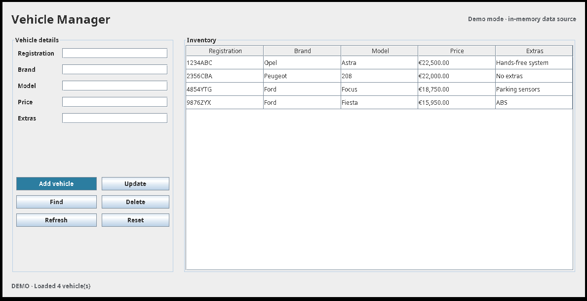
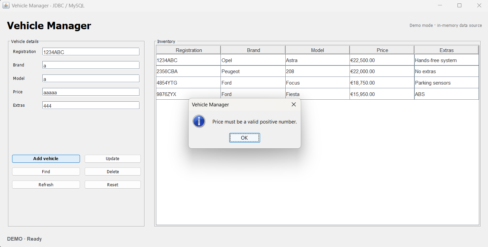
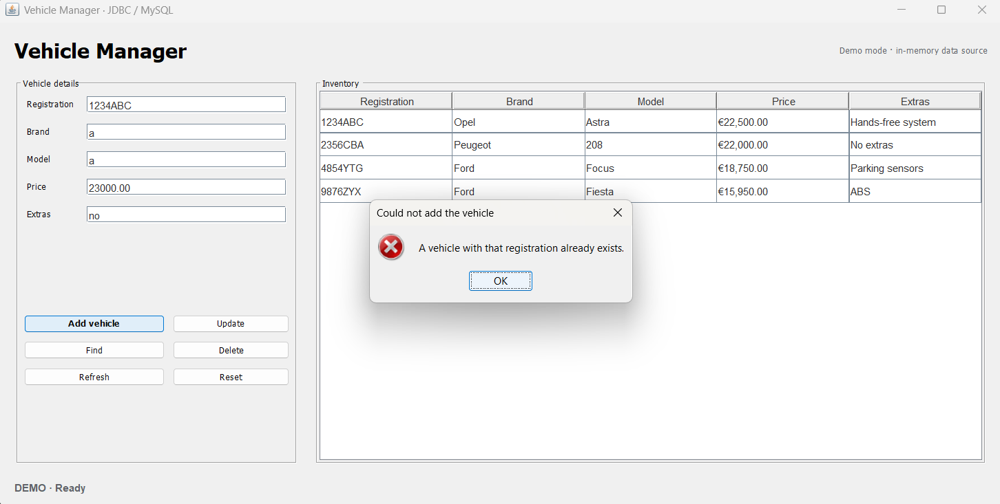
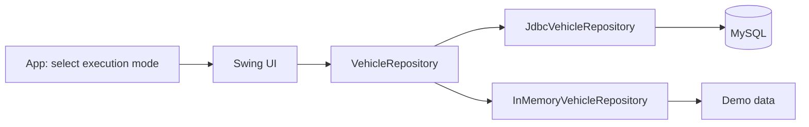

# 🚗 Java JDBC · Vehicle Manager

**Desktop vehicle inventory manager built with Java Swing, JDBC and MySQL, with a database-free demo mode.**


---

## 📌 About the Project

An academic JDBC exercise reorganized into a compact Maven application. Manage a vehicle inventory through a Swing interface, using MySQL for persistent storage or an in-memory repository to explore the application without setting up a database.

Database settings come from environment variables. SQL operations use prepared statements, and JDBC resources are closed with `try-with-resources`.

<table align="center" width="100%">
  <tr>
    <td colspan="2" align="center">
      <a href="docs/images/vehicle-inventory.png">
        
      </a>
      <br>
      <strong>Vehicle inventory</strong>
    </td>
  </tr>
  <tr>
    <td align="center" width="50%">
      <a href="docs/images/invalid-price-validation.png">
        
      </a>
      <br>
      <strong>Invalid price validation</strong>
      <br>
      Rejects non-numeric prices before saving.
    </td>
    <td align="center" width="50%">
      <a href="docs/images/duplicate-registration.png">
        
      </a>
      <br>
      <strong>Duplicate registration</strong>
      <br>
      Reports registrations already in the inventory.
    </td>
  </tr>
</table>

*All screenshots use demo mode. Click an image to view it at full size. Swing appearance varies by environment; the inventory overview predates the current native, bold Add vehicle button.*

---

## ✨ Features

- Add, list, update and delete vehicles.
- Find a vehicle by registration or select an inventory row to populate the form.
- Validate required fields, seven-character alphanumeric registrations and numeric prices.
- Report duplicate registrations and missing vehicles.
- Refresh the inventory and reset the form.
- Try CRUD operations with four sample vehicles in demo mode.

---

## 🛠️ Tech Stack

| Technology | Role |
| --- | --- |
| **Java 17+** | Application logic; Maven targets Java 17 |
| **Swing** | Desktop form, inventory table and dialogs |
| **JDBC / MySQL Connector/J** | Database connections and parameterized queries |
| **MySQL** | Persistent inventory storage |
| **Maven** | Compilation, dependencies and application launch |

---

## 🧠 How It Works



`App` selects the repository at startup. `VehicleManagerFrame` validates input and calls the operations defined by `VehicleRepository`; `Vehicle` holds each record. Both repository implementations support the same UI, keeping storage separate from presentation.

Demo changes remain in memory and are lost when the application closes. Normal execution connects to MySQL through JDBC.

---

## 📂 Project Structure

```text
java-jdbc-vehicle-manager/
├── database/
│   └── schema.sql                     # MySQL schema and sample records
├── docs/images/
│   ├── vehicle-inventory.png          # Inventory overview
│   ├── invalid-price-validation.png   # Numeric input validation
│   └── duplicate-registration.png     # Duplicate registration feedback
├── src/main/java/com/xandersdev/vehiclemanager/
│   ├── App.java                       # Entry point and mode selection
│   ├── model/Vehicle.java
│   ├── repository/
│   │   ├── VehicleRepository.java
│   │   ├── JdbcVehicleRepository.java
│   │   └── InMemoryVehicleRepository.java
│   └── ui/VehicleManagerFrame.java
├── .gitignore
├── pom.xml
└── README.md
```

---

## 🚀 Getting Started

### Requirements

- **JDK 17 or newer** and **Maven 3.9+**, available on `PATH`.
- **MySQL 8+** for persistent storage; demo mode does not require MySQL.

**Tested environment:** Windows 11, Java **21.0.11 LTS** and Maven **3.9.16**. The project still targets Java 17.

The commands below use **Windows PowerShell**. Run them from the project root after cloning:

```powershell
git clone https://github.com/xandersdev/java-jdbc-vehicle-manager.git
cd java-jdbc-vehicle-manager
```

### Compile

```powershell
mvn compile
```

Compilation does not require a running MySQL server. Maven needs internet access on the first run to download dependencies.

### Run the demo without MySQL

```powershell
mvn compile exec:java "-Dexec.args=--demo"
```

Add, edit, find and delete sample vehicles without configuring a database. Keep the entire `-Dexec.args=--demo` argument quoted in PowerShell.

### Run with MySQL

With the MySQL server running and its command-line client available on `PATH`, load the schema from the project root:

```powershell
mysql -u root -p --execute="source database/schema.sql"
```

Enter your MySQL password when prompted. The script creates the `concesionario` database, the `coches` table and four sample vehicles.

Configure the connection for the current PowerShell session and start the application:

```powershell
$env:DB_URL = "jdbc:mysql://localhost:3306/concesionario?useSSL=false&allowPublicKeyRetrieval=true&serverTimezone=UTC"
$env:DB_USER = "root"
$env:DB_PASSWORD = "your_password"
mvn compile exec:java
```

Replace the example credentials with your local MySQL account. If unset, `DB_URL` defaults to the URL above, `DB_USER` to `root` and `DB_PASSWORD` to an empty string.

---

## 📊 Results

The project compiles with `mvn compile`, and demo mode runs without MySQL. The screenshots show in-memory behavior; checking persistent CRUD operations end to end requires a configured MySQL server.
